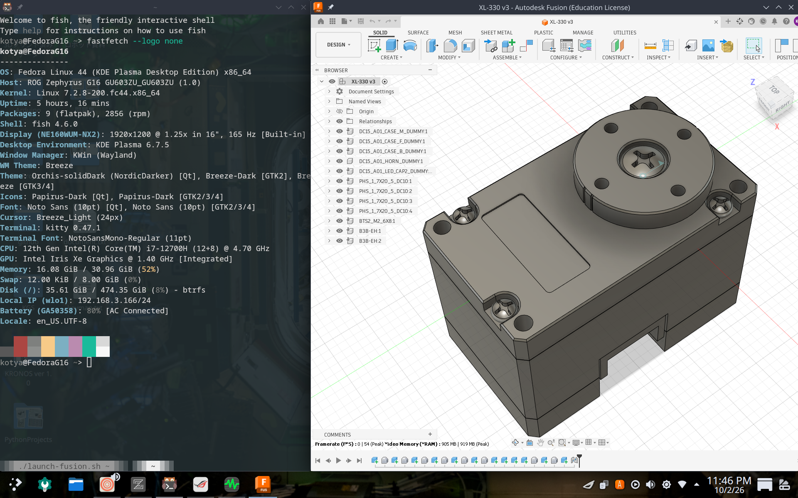
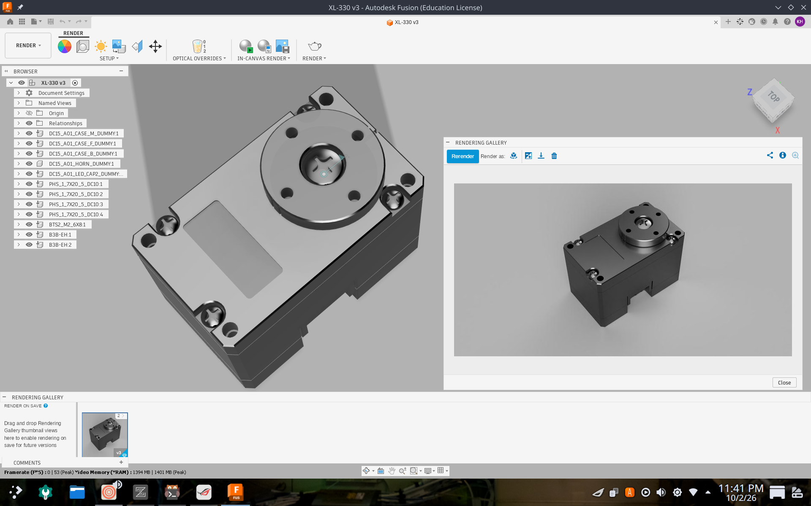
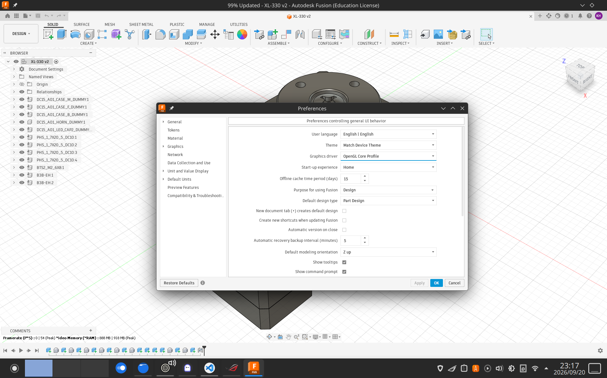

    _______          _              __   _____   _____
	|  ____|        (_)            /_ | /  _  \ /  _  \
	| |__ _   _ ___  _  ___  _ __   | | \ (_) / | | | |
	|  __| | | / __|| |/ _ \| '_ \  | | /  _  \ | | | |
	| |  | |_| \__ \| | (_) | | | | | ||  (_)  || |_| |
	|_|   \__,_|__ /|_|\___/|_| |_| |_| \_____/ \_____/

						 Turn Fusion 180° toward Linux.


Fusion180 is an unofficial, community-driven guide and script set for running **Autodesk Fusion** natively on Linux, using **GE-Proton** directly — **no Steam required**.




---

## Prerequisites

### Tested Environment

| Component        | Requirement |
|-------------------|---------------------------------------|
| Distro            | Arch(CachyOS, EndeavourOS), Fedora, Debian, Ubuntu |
| Desktop           | KDE Plasma 6 |
| Display server    | Wayland |
| Compatibility tool | GE-Proton 11-1 ~ 11-14 |

### Hardware Tested On

| Component | Model                         |
|-----------|--------------------------------|
| CPU       | Intel i7-12700H , Intel i5-6500T |
| GPU       | NVIDIA RTX 4050 , Intel Iris Xe , Intel HD Graphics 530 |

---

## Installation

**1. GPU drivers**

| GPU    | What you need |
|--------|---------------|
| NVIDIA | The proprietary NVIDIA driver  |
| AMD    | Mesa RADV on the `amdgpu` kernel driver. |
| Intel  | Mesa ANV (`mesa-vulkan-drivers` / `vulkan-intel`) |

The installer checks your GPU and Vulkan setup and tells you which side is missing if something is wrong.

**2. Get the Fusion180 scripts**

```bash
git clone https://github.com/Kotya31415/Fusion180.git
cd Fusion180
```

**3. Run the installer script**

```bash
./installer.sh
```

**4. Launch Fusion**

```bash
~/launch-fusion.sh
```
**5. Set Graphics Driver**


When using OpenGL, DXVK is essentially irrelevant for the corresponding rendering portion of Fusion. \
However, GPU acceleration still function via OpenGL. If you want to use DXVK, you must set Fusion to DirectX 11.\
In my environment, OpenGL works more reliably. (In GE-Proton 11-11)\
**DirectX 11 offers better performance, but it may cause problems. If you encounter any issues, please try OpenGL as well.**

---

## Update Fusion180
This update applies only to the Fusion 180 programs; it does not update Fusion 360 itself. You can update Fusion 360 in the same way as you would on Windows.

```bash
cd Fusion180
./update.sh
```
---

## Uninstallation

To remove the Fusion180 prefix created by the installer:

```bash
rm -rf ~/.fusion180
# Launcher and Window-fix program
rm -f ~/launch-fusion.sh ~/fusion-window-fix.py

# Application-menu entry, URI handlers and icon
rm -f ~/.local/share/applications/fusion180.desktop \
      ~/.local/share/applications/adsk-fusion360.desktop \
      ~/.local/share/applications/adskidmgr.desktop \
      ~/.local/share/applications/adskidmgr-handler.sh
rm -f ~/.local/share/icons/hicolor/256x256/apps/fusion180.png
update-desktop-database ~/.local/share/applications 2>/dev/null

# On KDE Plasma, if the entries still show in the application menu, rebuild the menu cache:
# kbuildsycoca6
```

This removes the directory at `~/.fusion180`. 


## Known Issues

| # | Symptom | Status / Workaround |
|---|----------|----------------------|
| 1 | A login screen appears during Fusion installation. | This is expected — **do not log in here.** Continue the install normally. |
| 2 | After signing in through the browser, Fusion shows a login error on its interface. | This is normal. Click **OK** to continue; you should be signed in correctly afterward. |
| 3 | It may not work properly with AMD graphics cards.  | I'm currently working on a fix. Please let me know if you find a solution! |

**If you run into something not listed here, please open an issue with your distro, kernel version, and full console output.**

---

## Disclaimer

> This project is an unofficial community guide and is not affiliated with or endorsed by Autodesk.
> Fusion is proprietary software and must be downloaded from Autodesk's official website.
